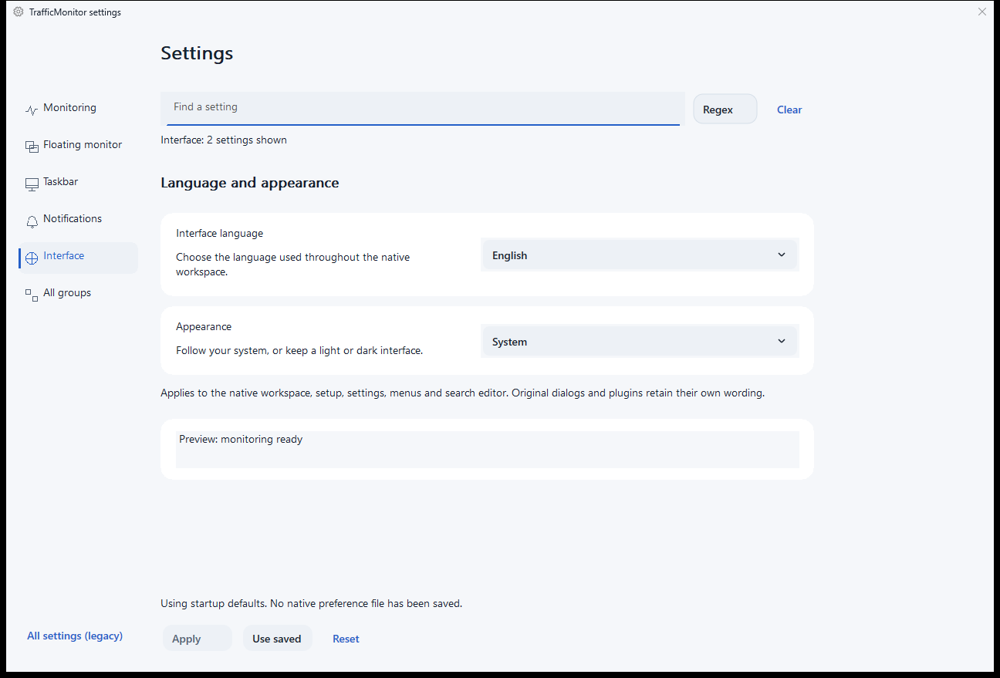
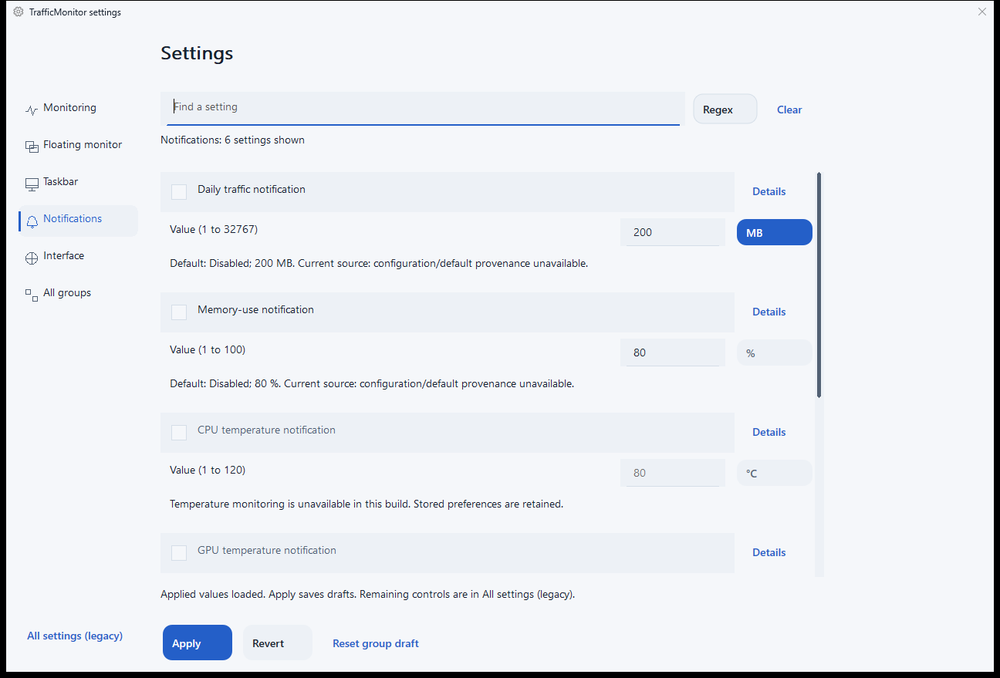
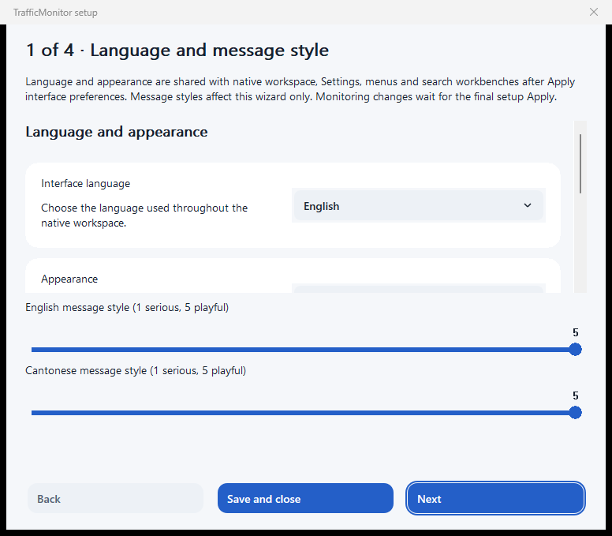
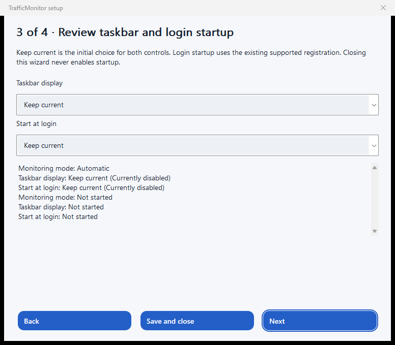
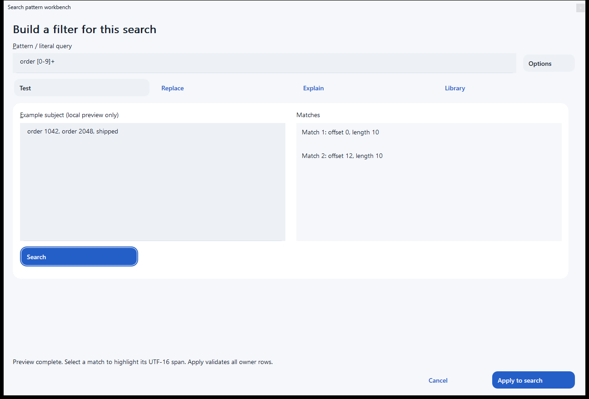
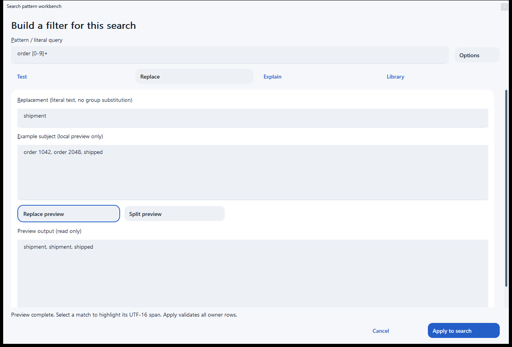

# TrafficMonitor

> **Incomplete preservation snapshot:** main includes unfinished native workspace and design work. Automatic product release is held by `.release-hold` while runtime verification remains incomplete. The release1.0.48 images below remain explicitly labelled before-state evidence.

The current [list measurement repair](docs/features/native-dashboard/list-layout-responsiveness.md) passes its native regression and local candidate build. A bounded portable comparison verified bilingual/dark Apply, responsive windows and unchanged normal-profile files; the full display matrix and finished remake remain incomplete.

The [compact Interface candidate](docs/features/native-settings/compact-interface-details.md), [grouped notifications](docs/features/native-settings/notifications-and-discovery.md) and [unified setup viewport](docs/features/native-dashboard/setup.md) now have bounded portable interaction evidence. Candidate 9048 fixes Preview Tab navigation and disabled-label rendering, verifies Details UIA ExpandCollapse, and covers the declared 960 × 760 setup reference size in all six language/theme combinations. The [source-bound receipt](docs/evidence/native-surfaces-9048.json) separates these results from the earlier 9047 matrix and still-unverified higher-DPI, reverse-keyboard and complete design acceptance. Candidates remain uninstalled.

A native C++/MFC network monitor for Windows, with a compact taskbar display, tray access and a floating monitor. This fork delivers the maintained x64 edition, preserves upstream attribution and supports the existing optional plugin interfaces.

[Documentation website](https://ding-ding-projects.github.io/TrafficMonitor/) · [Verified native 1.0.48 release](https://github.com/Ding-Ding-Projects/TrafficMonitor/releases/tag/v1.0.48-run40021045002-1) · [Native interface images](#released-native-interface-images) · [Installation](docs/features/installation/README.md) · [Changelog](CHANGELOG.md) · [Required-feature status](docs/features/required-features/README.md) · [简体中文](README_zh-CN.md)

## Install and start monitoring

Use the genuine unsigned Squirrel.Windows `Setup.exe` from the verified release. The x64 package includes its matching CRT/MFC runtime files. Fresh installed settings enable startup at the current user's interactive sign-in, show the taskbar display and hide the main window. Existing saved choices, traffic history, skins and plugins take precedence during updates. Tray actions remain available for settings, the main window, startup and exit.

Startup and shortcuts use the stable installation launcher. Uninstall removes only owned integration and preserves saved data by default. Optional hardware plugins are not silently installed; see [hardware support and acquisition](docs/features/installation/README.md). An unsigned installer can show an unknown-publisher warning. Current-host verification does not establish fresh-host acquisition, cancellation or a subsequent real sign-in.

## Silent updates and verified boundaries

The retained **1.0.48** installed-state receipt records source `ddcf441f4c3cab2a5e3b62e9ff6aff1babf3bdfa`, matching released executable/manifest bytes and preserved configuration/startup/history. Its [post-publication receipt](docs/evidence/accepted48-installed-state.json) is separate from the genuine natural transition below. All four 1.0.48 delivery jobs succeeded. The new native images below come from a separately verified portable 1.0.48 session, not a claim about a current managed installation.

A genuine bounded update moved naturally from **1.0.42 to 1.0.43**, source `575c871e0b6a52667bce1b77f69d62634e457455`. A real prepublication baseline and nine bounded observations verified matching released executable bytes, one successful apply, readiness and stable-launcher results, preserved configuration/startup and unchanged historical traffic records. No manual check, close, apply or launch occurred during that observation. All jobs in release workflow 40003469175 succeeded. See the [source-bound receipt](docs/features/installation/silent-natural43-acceptance.json). This proves one observed transition, not full GUI acceptance, negative production paths or long-term reliability. Earlier observations below retain their original scope.

The installed monitor checks on startup and every five minutes, validates the accepted release and package, and stages updates silently. It cooperatively restarts at a safe lifecycle boundary, preserving busy-work checks and the next-launch fallback. No Windows restart or sign-out is required or initiated.

An earlier verified accepted native installation was **1.0.42**, source `0411be2a7215ae119596d287f520b300312baf34`, with exact released executable bytes. Its post-fixture launcher restoration and bounded configuration/startup/history preservation are [recorded separately](docs/features/installation/accepted42-installed-state.json); this observation does not claim a continuously observed natural transition. Earlier normal **1.0.36** was bound to `f795e86b309cb72f80e030fe7c802ea9c44b4fd2`, with all four release jobs successful. One genuine **1.0.34 to 1.0.35** transition used a real prepublication baseline and verified exact released bytes, readiness/launcher results, one apply attempt and configuration/startup/history preservation. A subsequent automatic **1.0.35 to 1.0.36** transition used an explicitly post-publication preservation snapshot, with the earlier verified terminal state retained separately. These are two bounded observations, not long-term reliability or production-negative-path proof.

See [natural35 evidence](docs/features/installation/silent-natural35-acceptance.json), [natural36 evidence](docs/features/installation/silent-natural36-acceptance.json), and [update behavior and limits](docs/features/installation/silent-updates.md).

## Native interface work

The current visuals are not accepted as the finished redesign. A full native remake is in progress, including shared styled controls and scrollbars, coherent navigation, readable forms and every existing workflow. The first five shared surfaces and the remaining application-owned dialogs all remain in scope. The first shared component and Settings correction unit has independent source and actual-pixel review. Its selectors, search/edit-action menus, custom rails, draft-preserving language refresh and semantic navigation have bounded runtime evidence. Design references remain authored proposals, not product screenshots. Main application work takes priority over further documentation-website implementation.

The native monitoring backend, taskbar integration, tray and plugin interfaces remain. The new network workspace, task-oriented settings and resumable four-step setup are useful partial implementations. Setup opens through the explicit workspace action, with save/resume and acknowledged partial operations; ordinary sign-in monitoring remains unobtrusive. Language and appearance use shared stable native preferences with bounded cold-restart and five-consumer observations. Complete language/theme/accessibility coverage remains unfinished.

Bounded setup checks cover three languages, light/dark themes at actual 96 DPI, save/resume, Keep-current completion, forward Tab focus reveal and selected accessibility consumers. Choice expansion, complete keyboard/accessibility behavior, the physical scale matrix, full regex-builder parity and the broader required-feature inventory remain unfinished. The indexed 111-item ledger is an obligation inventory, not proof that 111 features shipped.

Read [shared native controls and preferences](docs/features/native-settings/native-components-and-preferences.md), [workspace](docs/features/native-dashboard/README.md), [setup](docs/features/native-dashboard/setup.md), [settings](docs/features/native-settings/README.md), [search](docs/features/search/README.md), [roadmap](ROADMAP.md) and [handoff](HANDOFF.md).

### Settings discovery and notifications

The integrated source adds independent group searches, cross-group discovery, a scrolling editor body and per-setting searchable explanation/default/revert menus. Notifications edit the existing daily-traffic, memory and supported temperature preferences through the existing consumer, retaining disabled values and unavailable capabilities. Invalid numeric drafts block application and reveal the offending row without losing other drafts.

Local candidate **1.0.9026**, source `30e300938a8502e9c2a1e8b35bb568b51ed7b716`, packaged successfully. Focused checks passed 46 cases, rejected the disposable old ownership behavior, then passed all 46 again. Real native checks verified repeated regex opening, invalid-value recovery, selected persistence and row actions; Chinese encoding was repaired and checked in the rebuilt application. Independent source and visual reviews approved this useful partial integration. The exact integrated root build and normal release1.0.43 are now verified separately, including one natural matching installed update. Earlier GUI evidence retains its original candidate source.

This is not complete Settings, complete regex parity or complete language/accessibility acceptance. Actual display evidence is 96 DPI only; bilingual/global language and appearance conversion, higher scales, UIA/full tab traversal and strict image promotion remain unfinished. See [behavior](docs/features/native-settings/notifications-and-discovery.md), [verification boundaries](docs/features/native-settings/verification.md) and the [source-bound migration inventory](docs/features/native-settings/migration-inventory.json).

## Offline documentation companion

The additional single-file documentation reader supplements the hosted website. Build it through `build.bat --docs-companion -Version <version>` or `build-installer.bat --docs-companion -Version <version>`. No adjacent runtime folder or separate installer is needed to launch the portable executable.

Local candidate **1.0.9024**, production source `421ac841a7825b682f0a67928be117c6b21c6ea4`, passed exact-entrypoint packaging, 40 local documentation checks and bounded real one-file interaction. Snapshot labels distinguish bundled release information from the installed monitor or companion package version; external source/download links remain local and visibly explained. A three-language, light/dark, normal/minimum home matrix passed at 96 DPI. Higher scales, full keyboard/accessibility and complete feature acceptance remain pending. This candidate receipt is not proof of a later integration build or a published companion asset.

See [companion build, runtime and release boundaries](docs/features/build/offline-documentation-companion.md). The integrated workflow attaches companion outputs to the same normal native release and fails clearly if that delivery is incomplete.

## Build

Run root `build.bat` for the maintained x64 native build and `build-installer.bat -Version <three-part-version>` for genuine Squirrel packaging. The entrypoints detect supported missing tools and obtain trusted pinned installers or verified portable packages, preserving existing installations and requiring the user's native consent when elevation is necessary. An unavailable licence, cancelled consent or unavoidable restart is an explicit incomplete result.

Use `build.bat --site` for the complete article/wiki website. Article production derives its inventory and immutable content from the held source, rather than silently reusing a historical manifest. See [build instructions](docs/build/README.md) and [build feature documentation](docs/features/build/README.md).

## Released native interface images

[Public native-interface gallery](https://ding-ding-projects.github.io/TrafficMonitor-gallery/) provides the same reviewed images with source details.

These are genuine, unedited native-window screenshots from **release 1.0.48**, captured on **2026-10-24 UTC**, in English/light appearance at **96 DPI**. They show the released interface **before the ongoing Material Design 3 refinement**. Oversized containers, generic controls and remaining visual inconsistencies are still being corrected; these images do not claim that the redesign is finished.

The six-image [source, hash and state inventory](evidence/ui/native-release48/inventory.json) and [verification boundaries](docs/features/native-dashboard/released-interface-evidence.md) distinguish real images from design proposals. A workspace image was excluded for privacy and incomplete chart rendering. No image was redacted or reconstructed.

Find settings and inspect notification controls

Use the first-run setup workflow

Test a pattern and preview a replacement

Earlier taskbar/upstream images remain in the [original README archive](docs/history/README-before-offline-companion.md). Earlier documentation-reader images retain their exact source and capture dates in the [documentation image archive](docs/history/documentation-companion-9024-images.md).

## Upstream and licence

TrafficMonitor originates from [zhongyang219/TrafficMonitor](https://github.com/zhongyang219/TrafficMonitor). This fork retains the [original licence](LICENSE) and upstream attribution. The complete earlier introduction, usage, skins, plugins, related links and image presentation remain available in the [historical README archive](docs/history/README-before-offline-companion.md); current operational guidance is organized in the documentation linked above.

## Documentation image archive

Earlier reader images and their original provenance are retained in the [documentation image archive](docs/history/documentation-companion-9024-images.md). They are not substituted for native application evidence.

## Work with patterns in task-focused views

The native workbench now separates Test, Replace, Explain and Library. A fixed pattern/options area and Apply/Cancel actions surround an independently scrolling task body. Styled native editing controls, selectable results, searchable expression selection and client scroll rails replace the previous stock control chrome. Source691 and local1.0.9040 have independent source/visual review and current-binary result selection, explicit Load, Apply/Cancel, forward-Tab and scrolling observations. Higher display scales, full keyboard/UIA/IME, formal image promotion and complete RegexBuddy parity remain unfinished. See [behavior and bounded evidence](docs/features/search/native-workbench.md#modern-native-workbench).
