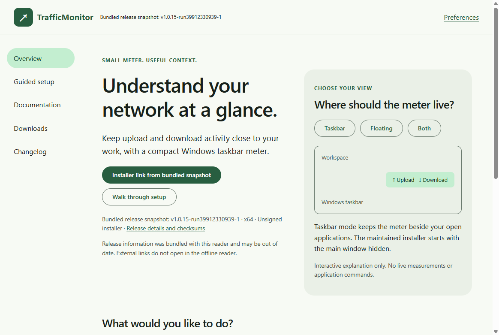

# TrafficMonitor

A native C++/MFC network monitor for Windows, with a compact taskbar display, tray access and a floating monitor. This fork delivers the maintained x64 edition, preserves upstream attribution and supports the existing optional plugin interfaces.

[Documentation website](https://ding-ding-projects.github.io/TrafficMonitor/) · [Native 1.0.43 release](https://github.com/Ding-Ding-Projects/TrafficMonitor/releases/tag/v1.0.43-run40003469175-1) · [Installation](docs/features/installation/README.md) · [Changelog](CHANGELOG.md) · [Required-feature status](docs/features/required-features/README.md) · [简体中文](README_zh-CN.md)

## Install and start monitoring

Use the genuine unsigned Squirrel.Windows `Setup.exe` from the verified release. The x64 package includes its matching CRT/MFC runtime files. Fresh installed settings enable startup at the current user's interactive sign-in, show the taskbar display and hide the main window. Existing saved choices, traffic history, skins and plugins take precedence during updates. Tray actions remain available for settings, the main window, startup and exit.

Startup and shortcuts use the stable installation launcher. Uninstall removes only owned integration and preserves saved data by default. Optional hardware plugins are not silently installed; see [hardware support and acquisition](docs/features/installation/README.md). An unsigned installer can show an unknown-publisher warning. Current-host verification does not establish fresh-host acquisition, cancellation or a subsequent real sign-in.

## Silent updates and verified boundaries

The latest verified installation updated naturally from **1.0.42 to 1.0.43**, source `575c871e0b6a52667bce1b77f69d62634e457455`. A real prepublication baseline and nine bounded observations verified matching released executable bytes, one successful apply, readiness and stable-launcher results, preserved configuration/startup and unchanged historical traffic records. No manual check, close, apply or launch occurred during that observation. All jobs in release workflow 40003469175 succeeded. See the [source-bound receipt](docs/features/installation/silent-natural43-acceptance.json). This proves one observed transition, not full GUI acceptance, negative production paths or long-term reliability. Earlier observations below retain their original scope.

The installed monitor checks on startup and every five minutes, validates the accepted release and package, and stages updates silently. It cooperatively restarts at a safe lifecycle boundary, preserving busy-work checks and the next-launch fallback. No Windows restart or sign-out is required or initiated.

An earlier verified accepted native installation was **1.0.42**, source `0411be2a7215ae119596d287f520b300312baf34`, with exact released executable bytes. Its post-fixture launcher restoration and bounded configuration/startup/history preservation are [recorded separately](docs/features/installation/accepted42-installed-state.json); this observation does not claim a continuously observed natural transition. Earlier normal **1.0.36** was bound to `f795e86b309cb72f80e030fe7c802ea9c44b4fd2`, with all four release jobs successful. One genuine **1.0.34 to 1.0.35** transition used a real prepublication baseline and verified exact released bytes, readiness/launcher results, one apply attempt and configuration/startup/history preservation. A subsequent automatic **1.0.35 to 1.0.36** transition used an explicitly post-publication preservation snapshot, with the earlier verified terminal state retained separately. These are two bounded observations, not long-term reliability or production-negative-path proof.

See [natural35 evidence](docs/features/installation/silent-natural35-acceptance.json), [natural36 evidence](docs/features/installation/silent-natural36-acceptance.json), and [update behavior and limits](docs/features/installation/silent-updates.md).

## Native interface work

The native monitoring backend, taskbar integration, tray and plugin interfaces remain. The new network workspace, task-oriented settings and resumable four-step setup are useful partial implementations. Setup opens through the explicit workspace action, with save/resume and acknowledged partial operations; ordinary sign-in monitoring remains unobtrusive. Setup language/style controls currently apply to the wizard only.

Bounded setup checks cover light theme at actual 96 DPI, three languages, save/resume, Keep-current completion and selected accessibility consumers. Choice expansion, complete keyboard/accessibility behavior, the full theme/scale matrix, full regex-builder parity and the broader required-feature inventory remain unfinished. The indexed 110-item ledger is an obligation inventory, not proof that 110 features shipped.

Read [workspace](docs/features/native-dashboard/README.md), [setup](docs/features/native-dashboard/setup.md), [settings](docs/features/native-settings/README.md), [search](docs/features/search/README.md), [roadmap](ROADMAP.md) and [handoff](HANDOFF.md).

### Settings discovery and notifications

The integrated source adds independent group searches, cross-group discovery, a scrolling editor body and per-setting searchable explanation/default/revert menus. Notifications edit the existing daily-traffic, memory and supported temperature preferences through the existing consumer, retaining disabled values and unavailable capabilities. Invalid numeric drafts block application and reveal the offending row without losing other drafts.

Local candidate **1.0.9026**, source `30e300938a8502e9c2a1e8b35bb568b51ed7b716`, packaged successfully. Focused checks passed 46 cases, rejected the disposable old ownership behavior, then passed all 46 again. Real native checks verified repeated regex opening, invalid-value recovery, selected persistence and row actions; Chinese encoding was repaired and checked in the rebuilt application. Independent source and visual reviews approved this useful partial integration. The exact integrated root build and normal release1.0.43 are now verified separately, including one natural matching installed update. Earlier GUI evidence retains its original candidate source.

This is not complete Settings, complete regex parity or complete language/accessibility acceptance. Actual display evidence is 96 DPI only; bilingual/global language and appearance conversion, higher scales, UIA/full tab traversal and strict image promotion remain unfinished. See [behavior](docs/features/native-settings/notifications-and-discovery.md), [verification boundaries](docs/features/native-settings/verification.md) and the [source-bound migration inventory](docs/features/native-settings/migration-inventory.json).

## Offline documentation companion

The additional single-file documentation reader supplements the hosted website. Build it through `build.bat --docs-companion -Version <version>` or `build-installer.bat --docs-companion -Version <version>`. No adjacent runtime folder or separate installer is needed to launch the portable executable.

Local candidate **1.0.9024**, production source `421ac841a7825b682f0a67928be117c6b21c6ea4`, passed exact-entrypoint packaging, 40 local documentation checks and bounded real one-file interaction. Snapshot labels distinguish bundled release information from the installed monitor or companion package version; external source/download links remain local and visibly explained. A three-language, light/dark, normal/minimum home matrix passed at 96 DPI. Higher scales, full keyboard/accessibility and complete feature acceptance remain pending. This candidate receipt is not proof of a later integration build or a published companion asset.

See [companion build, runtime and release boundaries](docs/features/build/offline-documentation-companion.md). The integrated workflow attaches companion outputs to the same normal native release and fails clearly if that delivery is incomplete.

## Build

Run root `build.bat` for the maintained x64 native build and `build-installer.bat -Version <three-part-version>` for genuine Squirrel packaging. The entrypoints detect supported missing tools and obtain trusted pinned installers or verified portable packages, preserving existing installations and requiring the user's native consent when elevation is necessary. An unavailable licence, cancelled consent or unavoidable restart is an explicit incomplete result.

Use `build.bat --site` for the complete article/wiki website. Article production derives its inventory and immutable content from the held source, rather than silently reusing a historical manifest. See [build instructions](docs/build/README.md) and [build feature documentation](docs/features/build/README.md).

## Current and historical images

Current rebuilt-native-interface image promotion remains pending complete timestamp/source receipts. Earlier taskbar and upstream interface images are historical and are preserved with their provenance in the [README and image archive](docs/history/README-before-offline-companion.md). No historical image is relabeled as evidence for a newer build. Two reviewed documentation-companion images below passed strict promotion at their actual producing source. They remain candidate evidence, not proof of a later build or complete feature acceptance.

## Upstream and licence

TrafficMonitor originates from [zhongyang219/TrafficMonitor](https://github.com/zhongyang219/TrafficMonitor). This fork retains the [original licence](LICENSE) and upstream attribution. The complete earlier introduction, usage, skins, plugins, related links and image presentation remain available in the [historical README archive](docs/history/README-before-offline-companion.md); current operational guidance is organized in the documentation linked above.

## Source-bound offline reader images

These exact raw images show local documentation candidate 1.0.9024 built from 421ac841a7825b682f0a67928be117c6b21c6ea4, not a later release. The inventory retains actual UTC capture times, original hashes and the bounded 96-DPI state. Higher scales and full keyboard/accessibility remain unverified. The minimum image shows the header and heading; lower content continues by normal vertical scrolling.

[Source/hash/state inventory](evidence/ui/docs-companion-9024/inventory.json).
